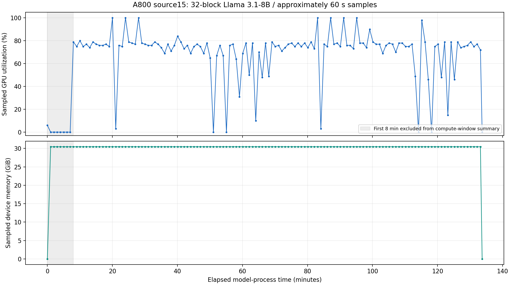

# source15 GPU 利用率记录

## 统计结果

原始记录为 `evidence/model-resources.jsonl`，每约60秒查询一次 nvidia-smi。共 135 个有效样本。

| 范围 | 样本数 | 样本平均值 | 中位数 | 最小 / 最大 |
|---|---:|---:|---:|---:|
| 全过程（含初始化、结束） | 135 | 66.13% | 76.0% | 0% / 100% |
| 第8分钟起，排除终态样本 | 126 | 70.81% | 76.0% | 0% / 100% |

后一区间中，利用率≥70%的样本 101/126；≥90%的样本 9/126；低于20%的样本 8/126。此区间设备显存采样范围为 31179–31179 MiB。

## 口径与限制

- 数值来自 nvidia-smi 的设备 GPU utilization，不是某个CUDA kernel的SM占用率，也不是显存利用率。
- 每60秒取一个短窗口读数，并没有保存这一分钟内的完整变化。表中“平均”是这些样本的算术平均，不是全程连续测量的精确忙碌时间比例。
- 计算区间按明确的第8分钟起点筛选：原日志先准备密钥和自举profile，随后开始32层。该筛选覆盖主要计算过程，排除了前8分钟初始化和最终进程已退出的0显存样本；它不是逐kernel事件边界。
- 样本时刻GPU显存维持约30.45GiB；RMM活跃分配峰值另见完整报告，两者统计口径不同。
- 本任务16:20结束时的最终样本为0MiB。16:22设备读数为33707MiB时，本任务进程已经退出；该读数未计入本次记录，不能归给已退出的模型进程。没有启动新的GPU测试。

## 曲线与原始数据

可缩放图为 `GPU_UTILIZATION.svg`，完整点列与统计为 `GPU_UTILIZATION_SUMMARY.json`。这些图仅解析服务器已有日志，没有在本地执行模型或使用本地GPU。
