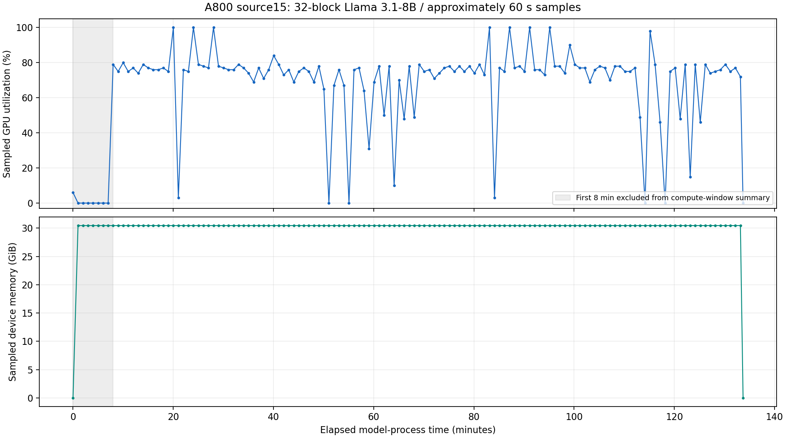

# Llama 3.1-8B API 版本测试结果及与 Cerium 的差异

日期：2026-11-13。测试版本：**source15**；与 source12/source13 的 C++ 源文件逐个 SHA256 一致。

## 1. 当前结论

**真实权重、完整32个Decoder Block已在单卡A800上连续完成密文计算，正常退出并产生有限输出；精度没有通过。**

这版实现了本轮“先完整执行并得到结果”的目标，但不能作为输出可靠的模型用于实际推理，也不能宣称已经完全复制了 Cerium 的全部执行实现。

测试容量为128 token，实际输入38个有效token；hidden=4096、FFN=14336、32个Q头、8个KV头。边界与选用的 Cerium benchmark 一致：加密embedding输入，经过32个Block，得到最后一个Block的密文hidden。验收程序仅在全部Block完成后解密，没有中间解密反馈或明文替代计算。本次不包含tokenizer、最终RMSNorm、LM head和增量decode。

## 2. 实测结果

| 指标 | 结果 |
|---|---:|
| 完成时间 | 2026-11-13 16:20，UTC+8 |
| 程序退出码 | 0 |
| 32层计算耗时 | 7558.47秒，即2小时5分58秒 |
| 模型进程耗时，含准备等 | 约8022.75秒，即2小时13分43秒 |
| 构建、组件预检、模型整个后台流程 | 8527.22秒，即2小时22分7秒 |
| 自举调用 | 9856次；每Block 308次 |
| RMM活跃显存分配峰值 | 21.50 GiB |
| RMM显存池保留量 | 30.03 GiB |
| nvidia-smi设备显存采样最大值 | 30.45 GiB |
| CPU进程RSS峰值 | 24.55 GiB |
| CPU资源 | 7核容器，OpenMP=7 |

内存数据对应正常释放不再使用的中间结果、逐层读取权重的执行方式，不是“保留全部中间结果”的最大占用。RMM活跃分配、池保留量和设备采样读数的统计范围不同，不能混作同一指标。

每个Block的自举分布为：Attention RMSNorm 22次、Softmax 208次、FFN RMSNorm 22次、SwiGLU 56次。9856条实际自举日志均为输入Q6、输出Q30、log2(scale)=40。Q表示当前剩余模数个数；每个Block末尾记录的第一个输出密文为Q6。

## 3. 精度结果与对照口径

| 指标 | 结果 |
|---|---:|
| 有效token最大实部绝对误差 | 9,554,791.1420 |
| 有效token RMSE | 1,103,488.9493 |
| 全槽最大虚部绝对值 | 2.9850 |
| 最终实部输出最大绝对值 | 9,554,780.5615 |
| 原1e-3精度门槛 | 未通过 |

对照文件是既有的 **Cerium original_callpath_v2：真实权重、float64近似packed运算、固定jitter**。它不是标准Hugging Face精确算子的输出，也不是当前C++每条指令的浮点重放。

因此，这次最终误差同时可能包含参考路径差别及密文数值误差，尚未通过逐阶段隔离试验证明各项原因的贡献。**不能把955万误差直接归因于自举，也不能认为只补上缓存或CUDA Graph就能消除误差。** 本轮按要求不以精度阻断执行，但误差很大这一事实必须保留。

## 4. GPU利用率记录

每约60秒记录一次nvidia-smi设备GPU利用率和显存用量，共135个有效样本。

| 统计范围 | 样本数 | 样本均值 | 中位数 | 范围 |
|---|---:|---:|---:|---:|
| 整个模型进程，含初始化及结束 | 135 | 66.13% | 76% | 0%–100% |
| 第8分钟起，排除结束样本 | 126 | **70.81%** | **76%** | 0%–100% |

后一范围内，101/126个样本达到或超过70%，9个达到或超过90%，8个低于20%。该区间显存样本均为31179MiB，约30.45GiB。

这里的均值是**采样点算术平均**，不是连续性能分析器测得的精确全程忙碌比例，也不是CUDA核心或SM的占用率。60秒间隔可能漏掉短暂空闲或峰值。

线性投影调用累计4900.26秒，占32层计算计时约64.83%。其中Gate、Up、Down合计3975.91秒。这个计时包含公开权重准备、数据传输及GPU计算，不能全部称为GPU kernel耗时；剩余时间也不能全部归为自举。

## 5. 与 Cerium 哪些相同，哪些仍不同

已沿用原始模型结构、主要非线性公式和系数、packed布局、BSGS分块思路、显式自举位置、融合RoPE掩码，以及“全部QK→全部Softmax→全部AV”的阶段顺序。

**未照搬不等于原则上做不到。** 下列差异分为接口契约不能直接替换，以及本版尚未完成的适配工作。特别是线性层和缓存，不能笼统归咎于“库不支持”。

### 5.1 自举算法、模数链和scale：按要求替换了后端，不能把原参数原封不动传入

- **Cerium：** 使用其自举函数、原模数和明文编码scale，例如`bootstrap_32K_35lvl_t1_vec_function`入口使用自己的level/scale契约。
- **本版：** 调用ResNet20使用的原生`GpuEvaluator::bootstrap`，使用当前Q49/P25参数、degree-22 profile及2^40接口scale；每次实际Q6→Q30。
- **为什么不能直接照搬：** 原始level数字、素数、密钥及变换矩阵与当前后端并非同一套参数。库会检查输入Q、scale和profile匹配；只复制数字或改密文元数据，不会得到等价计算。这里的底层自举替换属于用户明确允许的接口适配范围。
- **还可做什么：** 继续对齐输入幅值、实际scale、编码系数和输出语义；但必须重新验证，不能承诺换成相同公式就自动得到相同精度。

还有两处相关的接口差异需要明确：原 runner 的部分系数通过编码scale与声明scale共同表达数值，本版按当前后端实际追踪的物理scale换算系数；这属于表示转换，不能只逐字复制系数文件就假定等价。原SwiGLU函数末尾保留高scale乘积，本版为接入后续scale=2^40接口增加了真实的双Rescale，额外消耗模数并引入舍入。这些均不是新的多项式拟合，但仍需要单独检查误差；不能将“沿用公式”写成物理执行逐指令一致。

依据：Cerium [`bootstrap.py:656`](https://github.com/CMU-CAOS/Cerium/blob/6b487041f69bcd04fb2138b8be87635ddeb128d6/benchmarks/llama/bootstrap.py#L656)；API [`gpu_evaluator.cpp:5462`](https://github.com/SL640/FHE_GPU_Agent/blob/55e51804fb6ade2c420c75d3d2f3c727eb52e6de/gpu_api/src/poseidon/gpu/gpu_evaluator.cpp#L5462)；本版`source_runtime.hpp`。

### 5.2 双lane配对自举：当前profile不能直接替代原双输出契约，配对适配尚未实现

- **Cerium：** 向量自举接受两路，包装函数将两路按其特定表示合并，底层函数返回`z0`、`z1`两个输出。它不是简单把两次独立自举放在一个列表中。
- **本版：** 每个应用输入密文独立刷新，未复制这种配对和拆分；因此应用层自举调用数量不同。
- **为什么没有直接照搬：** 当前S2C-first路径的末尾会将结果与其共轭相加后返回单个输出。直接把两路数据当作任意实部/虚部合并后调用，并不能保证两路都被保留并正确恢复。必须重新适配配对布局、变换和拆分契约。
- **是否完全做不到：** 不能这样断言。库内部本身有实部和虚部分支，其他路径也有复数相关接口；缺少的是本版与选定ResNet20 profile兼容、且已验证的双lane应用适配。不能说整个库“不支持复数”或“不支持自举”。

依据：Cerium [`bootstrap.py:760`](https://github.com/CMU-CAOS/Cerium/blob/6b487041f69bcd04fb2138b8be87635ddeb128d6/benchmarks/llama/bootstrap.py#L760)；当前S2C-first输出合并见API [`gpu_evaluator.cpp:5656`](https://github.com/SL640/FHE_GPU_Agent/blob/55e51804fb6ade2c420c75d3d2f3c727eb52e6de/gpu_api/src/poseidon/gpu/gpu_evaluator.cpp#L5656)。

### 5.3 线性层累加、旋转及Rescale顺序：主要是当前适配未完成，不能说库绝对做不到

- **Cerium：** 在输入tile外准备可复用的baby旋转；跨输入tile累计分组结果，再统一做giant旋转和后续处理，保留较大的共享计算范围。
- **本版：** 对每个输入/输出tile及分支调用一次`dft_double_hoist`，每次调用完成本矩阵的旋转、乘加和Rescale后，才在外部累加。所选固定模式至少做一次Rescale；本版明确设置step=1。这也没有完整复制跨输出tile的旋转复用范围。
- **为什么这一版这样做：** 为先得到可执行的API版本，选用了ResNet20已使用的封装入口，并保持小范围工作区；它一次处理一个输入密文和矩阵组，不直接暴露原来跨多个输入tile的累计状态。这是适配选择及尚未完成的实现，不是证明原顺序不可实现。
- **核查后的更正：** 库底层`multiply_by_diag_matrix_bsgs_double_hoist`支持`rescale_count=0`；相关ResNet20验证代码也有`multiply_by_diag_matrix_bsgs(...,0,...)`再单独Rescale的示例。因此，早先若说“接口完全无法延后Rescale”，表述过强。
- **还需要什么：** 接入并验证不立即Rescale的路径，匹配累加时的Q/scale，恢复跨输入分组累计和可复用旋转的生命周期；只把Rescale参数改成0，仍不足以证明整个BSGS顺序已经与原版一致。这些工作尚未在source15实现和测试。

依据：Cerium [`llama_cerium.py:85`](https://github.com/CMU-CAOS/Cerium/blob/6b487041f69bcd04fb2138b8be87635ddeb128d6/benchmarks/llama/llama_cerium.py#L85)；固定高层路径 [`gpu_evaluator.cpp:5165`](https://github.com/SL640/FHE_GPU_Agent/blob/55e51804fb6ade2c420c75d3d2f3c727eb52e6de/gpu_api/src/poseidon/gpu/gpu_evaluator.cpp#L5165)；底层不Rescale路径 [`gpu_evaluator.cpp:5036`](https://github.com/SL640/FHE_GPU_Agent/blob/55e51804fb6ade2c420c75d3d2f3c727eb52e6de/gpu_api/src/poseidon/gpu/gpu_evaluator.cpp#L5036)；相关验证示例 [`bootstrap_precision.cpp:65`](https://github.com/SL640/FHE_GPU_Agent/blob/55e51804fb6ade2c420c75d3d2f3c727eb52e6de/gpu_api/Doc/analysis/resnet20_joint_chain_20260911/bootstrap_precision.cpp#L65)。

### 5.4 预编码、缓存重绑定与预取：有条件继续移植，本版采用了有限缓存和流式准备

- **Cerium：** 缓存与其编译后的输入名、partition、remapable内存偏移和执行计划绑定，支持设备内存、UVM或显式复制，并安排预取。
- **本版：** 沿用周期256的紧凑明文准备思路；公开常量按参数ID、精确scale和数值缓存，使用1GiB实数、128MiB复数的保留预算；矩阵流式准备，并预备下一块。没有复制原缓存管理器。
- **为什么不能直接复制原类就使用：** 两边的密文/明文对象、内存指针、编译元数据和分区描述不同，原偏移不能直接指向本后端对象。需要一层输入绑定和对象生命周期适配。
- **是否完全做不到：** 不是。缓存、预编码和预取策略可以继续移植。当前有限缓存是为先完成整模型执行的工程取舍，不能把它说成唯一实现，也没有证据证明A800硬件无法支持更接近原版的缓存策略。

依据：Cerium [`function_io.cpp:675`](https://github.com/CMU-CAOS/Cerium/blob/6b487041f69bcd04fb2138b8be87635ddeb128d6/cerium/runtime/execution/function_io.cpp#L675)、[`function_io.cpp:1080`](https://github.com/CMU-CAOS/Cerium/blob/6b487041f69bcd04fb2138b8be87635ddeb128d6/cerium/runtime/execution/function_io.cpp#L1080)及[`function_io.cpp:1140`](https://github.com/CMU-CAOS/Cerium/blob/6b487041f69bcd04fb2138b8be87635ddeb128d6/cerium/runtime/execution/function_io.cpp#L1140)；本版`source_ops.hpp`、`source_linear.hpp`。

### 5.5 全图调度与CUDA Graph：原实现依赖Cerium编译产物，当前尚未建立等价适配

- **Cerium：** 运行时读取编译后的函数、调用图、内存布局和分区描述，按配置构建CUDA Graph或多线程执行计划；不是仅对几行模型代码套一个Graph开关。
- **本版：** 普通C++按序调用ResNet20 API，以有限的CPU预备重叠GPU执行，保留必要的同步；未接入原调度器或CUDA Graph。
- **为什么不能直接链接原调度器就等价运行：** 原调度器管理的是Cerium生成的函数和缓冲区，不认识当前库对象及其调用生命周期。直接改用Cerium整套生成代码和后端，会偏离“用指定ResNet20 API搭建”的要求。
- **是否完全做不到：** 不是硬件不支持，也不是已经证明这些API不能捕获CUDA Graph。需要为本后端建立图节点/缓冲区适配，检查动态分配、主机同步和捕获兼容性。此项本版未实现、未验证；不能据此承诺移植后能提速多少。

依据：Cerium [`program.cpp:422`](https://github.com/CMU-CAOS/Cerium/blob/6b487041f69bcd04fb2138b8be87635ddeb128d6/cerium/runtime/execution/program.cpp#L422)及[`program.cpp:443`](https://github.com/CMU-CAOS/Cerium/blob/6b487041f69bcd04fb2138b8be87635ddeb128d6/cerium/runtime/execution/program.cpp#L443)。这也是可配置功能，不能仅凭源码存在就声称所有原版benchmark都默认启用了Graph。

## 6. 最终评价与证据

当前版本适合交付为**完整执行及性能分析的API benchmark基线**；尚不满足“全部执行细节完全复刻Cerium”，也没有满足精度要求。后续应优先补齐可实现但尚未完成的线性累加/旋转复用与配对接口；缓存和图调度需单独移植验证。任何一项都不能在测试前承诺消除精度问题。

- [完整逐层、level、自举及内存数据](FULL_MODEL_EXECUTION.md)
- [GPU利用率统计说明](GPU_UTILIZATION.md)
- [GPU利用率和显存曲线](GPU_UTILIZATION.png)
- 原始记录：`evidence/model.log`、`model-result.json`、`model-time.txt`、`model-resources.jsonl`。
- 输出SHA256：`2249a7591fd44eefd7334ee326bb99d70bedc4cc3777bb1cfc1701b0ab5dc3a6`。
- Cerium固定版本：`6b487041f69bcd04fb2138b8be87635ddeb128d6`；FHE_GPU_Agent基础版本：`55e51804fb6ade2c420c75d3d2f3c727eb52e6de`。

本报告仅整理现有服务器结果和源码核查；没有因编写报告再运行模型或启动新的GPU测试。
