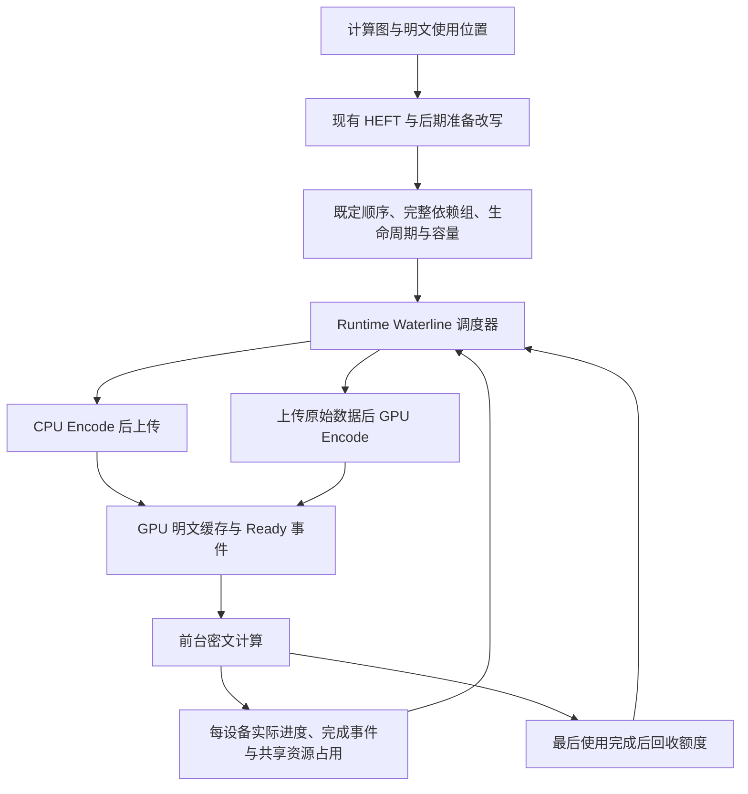

# Waterline：编译器与运行时协同的明文准备计划

**状态：首版Waterline与CPU/GPU完整编码及动态选择已接通，小图和压力验证通过；完整模型前向分配失败正在修正，数值验收尚未通过。** 更新日期：2026-10-14。

已执行范围与限制见 [验证入口](../test-results/waterline-20261013/README.md)与 [覆盖审计](../test-results/waterline-20261013/waterline-coverage-audit.md)。同配置完整 HEFT 前后保持审计已通过，见验证入口；完整模型数值验收仍在进行中，尚未通过；下述算法、IR与资源要求保持不变，不能以局部通过替代完整模型验收。

本版明确首版边界：保持现有 HEFT 的 Encode 已就绪假设、设备分配和前台顺序，后期增加物理准备操作；runtime 按消费者完整依赖成组准入，超过水位就暂停新组，依据真实 Ready 事件执行并滚动回收。首版不增加 Encode 成本模拟、最晚启动点推导、后端比例搜索或 HEFT 反馈迭代。设计从开始就面向单机多 GPU，单卡只是最小验证配置；成本驱动的编译器协同作为后续研究。

本文规定算法、IR 和资源语义；[实施、清理与 Qwen-0.6B 验收](poseidon-plaintext-prefetch-implementation-plan.zh-CN.md)规定任务次序、清理边界、提交及服务器操作，两者共同构成本阶段要求。最终目标是在 188Server 实际运行完整 Qwen-0.6B，不止交付设计或微基准。CPU worker、按需读取与 GPU Encode 能力已接入统一准备路径；旧 V3 静态分批已被替换，不要求长期保留另一套执行器。上述验证入口与覆盖审计界定已有证据，不代表 Waterline 已有完整模型端到端收益。

## 1. 目标与范围

CKKS 明文编码会把原始权重扩展为较大的 RNS/NTT 表示。预先编码并常驻全部明文需要大量显存；到消费者执行时才编码和上传，又会把准备延迟暴露在关键路径上。CPU 编码主要消耗主机计算资源，并需要上传较大的编码结果；GPU 编码可以上传原始数据，但会与密文计算竞争 GPU 计算和内存资源。

Waterline 将这两条路径纳入同一个准备调度。首版编译器沿用现有 HEFT，仅补充准备操作、依赖分组、生命周期和资源检查；runtime 根据实际进度和队列状态选择完整的 CPU Encode 或 GPU Encode，提前准备近期需要的明文，并将显存占用维持在可配置的水位附近。是否进一步让编译器模拟编码和传输成本，由首版测量结果决定。

本阶段以消费者的完整依赖 batch 为资源准入单位，以每份完整明文为后端选择和 Encode 提交单位，不将同一份明文拆成 CPU FFT 与 GPU RNS/NTT 等跨设备阶段。两条候选路径为：

```text
CPU 路径：读取原始数据 → CPU 完整 Encode → 上传编码明文 → GPU 可用
GPU 路径：读取原始数据 → 上传原始数据 → GPU 完整 Encode → GPU 可用
```

目标是在内存受控、数值语义正确的前提下，减少前台等待明文的时间，并限制后台准备对前台的干扰。缓存填满率、GPU 利用率和 Encode 吞吐量是诊断指标，不能代替端到端性能目标。

首版面向已知计算图中的权重明文、单机单 rank 的一张或多张 GPU。设备标识、水位、完成进度和准备队列从开始就按设备管理，CPU 与 Host 资源统一协调；先用单卡定位问题，随后用全部 GPU 验证相同机制，不另做一套多卡 IR。188Server 单卡优先使用物理 GPU 1，多卡必须使用全部 GPU，不运行双卡等子集配置。跨机器调度、单份 Encode 的 CPU/GPU 阶段拆分、纯 Tensor Core 编码和明文压缩布局均不属于本计划的必要条件。

本文区分四个概念：**依赖 batch**是围绕一条消费者指令形成的完整依赖准入组；**滚动预取窗口**是当前允许提前准备的候选范围；**执行区间**是确有 Fence 时两次整体等待之间的计划片段；**Encode batch**是一次 GPU 批量编码的任务数。它们都不等于模型输入的 `batch_size`。依赖 batch 只决定是否一起取得资源额度，不引入批末 Fence；组内可以逐份 Encode 和上传。

## 2. 可用于论文方法部分的描述

### 2.1 核心机制

Waterline 是一种在既定前台调度上进行动态明文准备的机制。编译器保持现有 HEFT，提取明文的使用顺序、编码参数、生命周期和设备位置，形成完整依赖分组并检查容量。运行时按组准入，以每设备可配置的显存水位限制提前准备规模，并一起落实消费者的执行空间；下一完整组会越过水位时暂停补充。CPU/GPU 后端按简单的运行时策略选择，输入尚未准备好时消费者等待真实 Ready 事件。已准入组继续准备和执行，最后使用完成后按事件归还额度，再尝试下一组，无需批末 Fence。前台工作到来时停止提交会与之冲突的非紧急准备，其必需准备继续推进。各设备执行和回收独立进行，共享的 CPU、Host 内存及传输链路统一协调。

该方法将三种决策关联起来：**何时准备、在哪里编码、允许提前驻留多少数据**。首版编译器提供既定调度、依赖和资源边界，runtime 处理准备时机及实际等待。正确性依赖显式的数据就绪和内存生命周期，不依赖 HEFT 预测时间准确；首版也不声称得到联合优化的计算与准备调度。



### 2.2 研究假设与贡献边界

待验证的首版假设是：保持现有前台调度时，按完整依赖成组准入、由 runtime 动态准备明文，仍可比仅按需准备减少端到端等待，并控制显存和前台响应延迟。CPU-only、GPU-only 与简单混合策略作为对照；如果准备等待或资源竞争使原设备分配明显不合适，再研究编译器联合优化。

论文的方法重点应放在完整依赖准入、执行空间保证、水位与有界后台提交如何共同工作。可配置的缓存水位本身不足以支撑新颖性主张。相关工作比较和完整实验尚待完成，不预先声称最优调度、零干扰、硬实时响应或已获得加速；后续成本驱动规划须作为独立扩展验证。

## 3. Waterline 的定义和内存约束

### 3.1 配置水位与实际可用预算

对每张 GPU `d` 分别定义以下量，容量单位统一为字节：

| 符号 | 含义 |
| --- | --- |
| `M_d` | 配置允许该执行器使用的 GPU 总容量，不能超过设备容量 |
| `alpha_d` | waterline 比例，例如 `1/2` 或 `2/3`，满足 `0 < alpha_d < 1` |
| `K_d` | 密钥、参数表等常驻占用 |
| `F_d(t)` | 当前驻留的前台对象与已准入依赖 batch 承诺的输出、算子及通信空间；共享对象不重复计费 |
| `S_d` | 尚未归入前述项的分配开销、碎片及安全余量 |
| `P_d(t)` | 时刻 `t` 已承诺给明文准备和驻留的额度 |

定义明文硬预算和机会性填充目标：

```text
H_d(t) = M_d - K_d - F_d(t) - S_d
W_d(t) = min(alpha_d × M_d, H_d(t))
```

`H_d(t)` 为负，或一个不可拆分的必需工作集合超过预算时，应报告该配置不可行，不能靠继续预取解决。`F_d(t)` 包括已承诺但尚未实际分配的空间；组内执行所需资源在开始准备前落实，不在取齐输入后再争抢工作区。

runtime 根据分配、提交和完成事件更新实际占用与已承诺额度，设备内存查询用于核对。前台空间随已准入的完整依赖组计算，不固定预留全模型峰值。已有分配/复用顺序可以继续使用，但前一使用未真正结束时不能归还额度；分析窗口切换也不代表旧任务完成。第 3.4 节给出按组准入规则。

首版严格按整组检查水位：加入下一依赖 batch 后超过 `W_d(t)`，就不准入该组。检查使用加入该组前台预留后的 `F_d`，同时覆盖 GPU 硬容量和共享 Host/pinned 预算。消费者请求只提升优先级，不绕过水位。若即使先前各组执行结束，必要的一组与仍须保留的对象也装不下，则报告所需容量及配置水位，不能永久等待。调整水位或改变计算划分应显式进行。

例如，假设配置容量为 32 GiB、`alpha=1/2`，扣除常驻、前台和安全预留后剩余 18 GiB，则明文水位为 16 GiB。若加入下一组的前台预留后只剩余 12 GiB，该次准入的有效水位就是 12 GiB。这里的数字仅解释定义，不是测量结果或默认推荐值。

### 3.2 先预留，再分配

`P_d(t)` 至少包含以下互不重复的项目：

- 已就绪且仍驻留的明文，以及逻辑 Release 后尚未真正可复用的明文。
- 已获准提交的 GPU 目标缓冲，即使上传或 Encode 尚未完成。
- GPU Encode 输入、输出和工作区的同时存活峰值预留。

每次以完整依赖 batch 取得额度，再逐项分配和提交。首版让单个调度线程拥有任务状态和额度账本，worker 只返回完成消息，无需为每份明文引入一套并发事务。任务完成后按实际可复用的空间归还额度，输出仍驻留的部分继续计费。不能只统计 Ready 明文，否则多个未完成任务会共同突破水位。

硬约束为 `K_d + F_d(t) + S_d + P_d(t) <= M_d`。它成立的前提是所有相关分配经过一致的记账，且预留覆盖实际峰值；在覆盖不完整时，报告只能称为已计费对象的预算，不能声称总显存有上界。内存池保留的空闲块要区分可复用额度与不能复用的占用，避免漏算或重复计费。CUDA 空闲显存采样仅作核对，不能作为唯一准入依据。

原始数据缓存、CPU 编码结果和 pinned buffer 分别具有 Host 预算。CPU 可以继续提前编码已准入组的数据，但不能绕过组准入累积远期结果。多 GPU 还需共享 CPU、Host 内存和 PCIe 带宽预算。

### 3.3 水位变化与前台进展

启动时按消费者顺序准入完整依赖 batch，在初始化窗口内向 `W_d(t)` 填充。下一组会越过水位，或窗口中已无合法候选时，结束初始填充；不为凑满水位跳过前面的组。启动填充成本要单独报告，并计入冷启动时间。

运行中随消费和回收补充。首版仅使用一个上水位；有额度且存在合法候选就考虑提交，没有则等待下一次进度或回收通知。只有测量表明频繁启停有明显代价时，再增加低水位滞回参数。水位不能代替 GPU 工作量限制。

调整配置预算前必须检查仍驻留和仍在执行的任务是否满足新预算，不能靠降低水位撤销已承诺的空间。资源紧张时停止新组准入，继续已准入组的准备和执行，按实际完成事件归还额度；后续组不能挪用前面各组的输出和工作区预留。

使用短滚动窗口，按顺序成组准备，不做任意缓存淘汰或取消后重新编码。空间不够时不取半组、不跳过它取远期组；已准入的各组继续运行。组内尚缺的明文已有额度，可以继续准备，不因水位已满而停在半途。已有显式 Fence 的计划继续遵守边界，不默认跨越它预取。

### 3.4 以一条指令的完整依赖为准入粒度

一个依赖 batch 围绕一条消费者指令形成，包含它尚未就绪的明文准备，以及执行这条指令所需的输出、工作区和通信空间的额度。已经驻留或由前面已准入组产生的输入只引用，不重复编码、上传或计费。完整依赖指该指令的全部直接输入；上游密文计算按计划顺序先准入，不把整张上游图合成一个巨型 batch。没有明文输入的计算和通信也经过相同的资源准入。

例如 `I = f(cipher, p1, p2)`：先检查 `p1+p2` 的完整准备空间，以及 I 的输出和工作区是否都能落实；能够落实才准入，然后可以先后编码和上传 p1、p2。不能只为 p1 取得额度，把 p2 留到水位满后再等待。若 p1 已由前一组准备，此次仅为新增资源取得额度。

首版只需要以下规则：

1. **按计划顺序取完整组。** 编译器给出包含计算、通信和准备依赖的合法拓扑顺序。新组准入沿这个顺序形成连续前缀；某组的执行边界、容量或水位条件不满足时停止补充，不跳过它占用远期资源。组内消费者的前驱必须已完成，或属于前面已准入的组。
2. **先判定整组，再分配。** 调度器一次判定整组新增的 GPU、Host/pinned 额度，以及消费者的输出和工作区。已经存在的共享输入只计一次。额度属于逻辑承诺，不要求立刻把全部缓冲物理分配；后面的组不能借走它。
3. **把在途准备算入水位。** 检查的是当前已承诺量加下一整组的新增峰值，不是单个 batch 的大小，也不是仅 Ready 明文的总量。`P'_d = P_d + delta_plain_d`、`F'_d = F_d + delta_front_d`；要求各卡 `P'_d <= min(alpha_d × M_d, M_d - K_d - S_d - F'_d)`，同时满足 Host/pinned 预算。超过就整组不取。
4. **已准入组继续完成。** 水位已满不阻止组内尚未提交的 Encode、上传和计算取用其已有额度。最后一次使用真正完成后归还可复用空间；共享输入和后续仍需使用的密文输出继续保留。一次消费不承诺全部输入立即释放。

前台工作区若在既有 stream 顺序和完成事件下能够复用，可以共享额度；不同组可能同时使用的空间必须分别计费。首版先采用易验证的组内峰值上界，再根据测量细化复用。不用总显存查询替代这些已承诺资源的记账。

**依赖 batch 是准入单位，不是同步单位。** 可以先后准入多个完整组，让已满足依赖的计算、上传和 Encode 重叠；不在组尾插 Fence，也不要求各 GPU 一起结束。为保持这版规则简单，跨卡新组也遵守同一拓扑准入前缀，因此前面某组放不下时，可能暂停其他卡后续新组的准入；已准入组继续独立执行。跨过阻塞组的预取不在首版中启用。

### 3.5 为什么能够前进，以及配置不可行时如何处理

编译时先检查一个简单基线：按照同一拓扑顺序，每次仅准入、执行一个完整依赖组；上一组结束后保留后续仍要使用的对象。这个顺序必须在给定 waterline、各设备容量及 Host/pinned 预算内完成全图。此检查不依赖耗时预测，不搜索所有可能的执行顺序。当前已有 Waterline 编译期单组检查与 runtime 后端资源预检；工作区上界仍须由后端分配规则或容量接口给出，只统计对象的串行内存报告不能直接当作完整检查。

在基线可行的前提下，按组准入的前进论证是：

- 新组总在前面的组之后准入，已准入组的依赖不会指向尚未准入的组。
- 每个已准入组都有完成准备和消费者执行所需的资源额度。因此暂停新组后，最早尚未完成的组仍能执行；依次推进，所有已准入组能够完成。
- 这些组完成后，留下的是这个计划前缀本来就需要保留的对象，不含跳过前面指令而提前取来的远期数据。此时回到上述单组基线的对应状态，下一组能够准入；如此继续至结束。

该论证要求执行图无环、资源上界正确、任务最终完成，并且 worker 能公平推进已准入任务。Host 消费者不能占住唯一 CPU worker 等待尚未执行的 Encode；stream 不得等待排在自己后面的生产任务；通信双方的提交与接收空间必须落实；完成处理与回收不能被等待者持锁阻塞。这些沿用依赖、worker 分派及事件生命周期规则处理。

若单组基线在某一步已经超过 waterline 或硬容量，就报告该组、仍驻留的对象及所需容量，要求调整配置或计算划分。尤其是单组自身超过水位，或长生命周期明文加下一组超过水位时，单纯等待不会有用。runtime 若发现没有在途组可完成、下一组却仍无法准入，应报告计划/记账不一致，不能一直等待显存释放。

这里不需要每次预取搜索“可行后续顺序”、维护后缀安全摘要或新增防死锁 IR。runtime 只做连续整组准入、资源记账和完成回收；编译器复用已有计划顺序、操作数与生命周期信息建立组及检查单组基线。共享明文归首次需要它的组准备，后续组引用同一结果；无需新增一份重复的依赖列表。

## 4. IR 的具体语义

### 4.1 当前实现的起点

默认 `eager` 不运行明文准备改写；当前可选 `waterline` 路径运行 `PlanPlaintextWaterline`，替换了 2026-10-10 加入的静态 `stream` 分批路径，不生成批次 Fence。计划没有 Fence 时，runtime 不会自动定期切批。资源准入、异步准备和完成回收已接入现有 worker；不能把历史可选分批路径视为原有 runtime 的唯一架构。具体清理边界见实施文档第 2 节。

当前代码有三种不同的估算，不能混用：

- [Earth LatencyEstimator](../third_party/ckks-runtime/third_party/dacapo/lib/Dialect/Earth/Transforms/LatencyEstimator.cpp)累加算子成本，用于较早阶段的估算，不模拟异步准备队列。
- [AssignPlacement](../third_party/ckks-runtime/third_party/dacapo/lib/Dialect/CKKS/Transforms/AssignPlacement.cpp)使用 HEFT 风格列表调度，并写出 `dist.schedule_start/finish`。其 `buildGraph` 将 Encode 设为 Host 上时刻 0 已就绪的源，Encode 不进入计算调度节点。因此它尚未模拟在线编码。
- [PlanPlaintextWaterline](../third_party/ckks-runtime/third_party/dacapo/lib/Dialect/CKKS/Transforms/PlanPlaintextWaterline.cpp) 在 HEFT 后改写 Prepare 并检查单组容量；`EstimateRuntimeMemory` 按顺序完成假设统计对象生命周期。它们都不是包含实际异步准备的时间模拟器。

首版保持现有耗时估算器和 HEFT 算法不变，用后期准备改写、分组及资源检查替换旧静态分批策略。早期 scale/boot 优化器和所有数学算子的语义不因此改变。

### 4.2 只新增一个后期物理操作

保留纯数学层的 `ckks.encode`。在完成 placement 和通信物化后，将目标 GPU 的“Host Encode + 直接上传”改写成 `dist.prepare_plain`，结果仍为现有明文类型并具有固定目标设备。以下为设计示意，尚不是可解析的 MLIR 语法：

```mlir
// before
%host_p = ckks.encode {payload = ...}
%p = dist.transfer %host_p {destination_device = 0, ...}
%y = ckks.mulcp %x, %p

// after: 首版不要求时间锚点或编译器后端建议
%p = dist.prepare_plain {payload = ..., dist.device = 0}
%y = ckks.mulcp %x, %p
dist.release %p
// 继续后续计算和预取；此处不自动插入 Fence
```

`prepare_plain` 的语义是：为这个逻辑结果选择一条完整准备路径，最终在指定设备发布可用的 NTT 明文。它允许延迟执行，但不能被当作无副作用常量折叠、跨 Fence 合并或任意移动。为其声明准备和分配的调度副作用；payload 的数学去重仍在更早的 `ckks.encode` 阶段完成。

首版只新增准备操作，内容、结果 ID、编码类型和设备复用已有表达；首次/最后使用从 SSA 和 Release 得到，资源大小由类型和后端容量接口推导。waterline、后端策略与在途限制放在计划级配置；首版按单份明文提交 Encode，不要求批量编码参数。首版不生成或读取 `after`、`start_by`、`backend_hint`，也不复制消费者列表、每任务预算表或 NTT 节点。

采用新操作而不是在现有 Host Encode 上增加 `auto`，是为了保持类型和位置明确：CPU 路径产生 Host 临时值再上传，GPU 路径上传原始数据后编码，两者都发布同一个固定 GPU 结果。若仍保留旧的显式明文上传，则 GPU 路径会面对不存在的 Host 结果或多余传输。

两条内部路径的传输均需真实执行、计入资源和 trace，封装不意味着传输免费；首版不将新路径耗时反馈给 HEFT。原有密文、普通明文 Transfer 的语义不变。共享 Host Encode 还有其他消费者时，仅改写满足该模式的分支，不删除仍被引用的原操作；每个目标设备分别有自己的物理准备结果。

`ckks.encode` 与 `dist.prepare_plain` 可以共存于同一份 V4 Waterline 计划。例如一份明文保留 Host Encode 后显式上传，另一份由 Prepare 选择后端。被替换路径只执行 Prepare，原 Encode 无其他使用者时删除，不重复编码。同一个逻辑 Encode 可以对应不同设备或不同使用时段的多个物理 Prepare。当前 reader、writer、二进制 I/O、Verifier 和 runtime 已共同支持 Prepare；它要求 V4 Waterline，不能把新操作写入旧 V3 计划。

### 4.3 不增加时间锚点

首版最早开始条件由真实依赖、完整组准入和资源额度决定；消费者请求时提升其必需准备，不推导“最晚开始时间”。现有 HEFT 时间戳不能被解释成 Encode 的期限。时间锚点、成本模拟和后端比例优化不属于本阶段，不为它们预埋字段或框架；将来有测量证据时再独立设计。

### 4.4 水位控制不依赖批次 Fence

Waterline 不在每组权重之间自动插入 Fence。某份明文完成最后使用并归还空间后即可尝试准入下一组，已准入各卡工作独立推进；新组仍遵守统一拓扑前缀，不能跳过阻塞组。水位达到上限时暂停新组，不要求所有设备一起结束。

替换旧静态划批和批次执行分支，不要求保留旧 V3 批次执行器作长期兼容或性能对照。最近的实验计划可重新生成，历史对照可在 Git 对应版本复现。先核对真实使用方；若仍有非分批用途的显式 Fence，保留或迁移其严格完成语义，不能静默忽略。

有实际用途的整体边界仍须交付已提交的 CPU/GPU/通信结果并清理异步引用，后续仍使用的值继续保留；程序收尾使用原有 drain 即可，无需另加等价 IR。局部就绪继续使用真实完成事件。增加统一预算准入、有界提交和持续回收后，再删除原来负责限制积压的旧分批代码，不能仅去掉等待而留下无界在途资源。

### 4.5 哪些算子需要改变

| 对象 | 改动 |
| --- | --- |
| `ckks.encode` | 数学语义保持；符合条件的物理 Encode/Transfer 组合在后期改写 |
| 新 `dist.prepare_plain` | 固定 GPU 结果，具有准备和分配副作用；首版不加时间锚点 |
| `dist.transfer` | 普通传输保持；被准备操作封装的传输在 runtime 内部执行和计量 |
| `dist.release` | 保留最后使用与异步保活语义，覆盖准备结果 |
| 旧批次 `dist.fence` | 删除自动生成和专属执行机制；仅有实际其他使用方时保留相应严格边界 |
| MulCP、AddCP、Rotate、Rescale 等 | 不加 encode、waterline 或 deadline 属性；继续遵守普通输入依赖 |
| 函数/计划配置 | 存放 waterline、Host/pinned 预算和在途提交限制，不逐操作复制 |

## 5. 首版与 HEFT 的关系：固定前台调度，动态准备输入

### 5.1 保留什么，不把哪些预测变成执行条件

首版不修改 `AssignPlacement` 的调度算法。继续把 Encode 当成时刻 0 已完成的 Host 源，沿用既有设备分配、算子优先级和每设备前台顺序。这里的“Encode 已就绪”不等于所有 GPU 上的数据都已就绪：已有通信成本项仍按原配置计算，真实的数据传输和 Ready 依赖也继续保留。

当前 `AssignPlacement::applyPlacement` 用预计起止时刻形成编译期排列，并写出 `dist.schedule_start/finish`；runtime 计划的 Compute 指令没有按这些时刻启动的字段。当前 `execute_parallel_compute` 先解析真实输入，再调用计算 API；Prepare 已接入真实完成依赖，不能把编译器的“已就绪假设”带入执行器。

因此两者可以组合：HEFT 决定既定设备和顺序，Waterline runtime 决定准备何时真正开始；消费者在输入 Ready、前驱满足、执行空间已落实时执行，晚到就等待。首版不因等待而重新 placement 或改排其他前台指令。独立设备上已准入且依赖满足的工作仍可并行。

HEFT 时间戳保留为原成本假设下的估计，不要求首版重新预测总耗时，也不宣称它们是 Waterline 的真实起止时刻或耗时上下界。CPU/GPU Encode、传输路径变化和共享资源竞争可能使预测失准；原有设备分配也可能不再最优。内存释放、复用和跨 stream 使用必须依赖真实完成事件，不能依赖预测的时间间隙。

### 5.2 首版只增加后期功能与简单运行时策略

编译器在 HEFT 之后做 Prepare 改写、完整依赖分组、类型/位置检查、Release/reuse 与单组容量检查。这些是功能和生命周期改造，不建立新的 Encode 时间模拟器，不计算 CPU/GPU 比例、最早/最晚时间或资源空隙的最优插入位置。

runtime 已支持 CPU-only、GPU-only 和 Auto 配置，各自准备、上传、等待和回收的测试范围见验证入口与覆盖审计。简单混合策略先筛选受支持、能满足整组额度的路径，再采用 CPU 优先：组准入时 CPU worker 空闲则选 CPU；CPU 忙、目标 GPU 无在途前台计算且无可运行前台工作时，可选 GPU 路径；GPU 路径暂不可用时可以排入有额度的 CPU 队列等待，不据此修改前台顺序。前台因缺少这份明文而等待，不应被误判为禁止其必需 GPU Encode 的理由。没有路径满足额度时暂停新组，启动后不迁移。

该策略只查询实际队列、事件和容量，不依赖编码耗时预测。所有已准入准备按公平规则取得执行机会，消费者请求可提升所依赖的准备。首版只在 GPU 实际空闲或前台等待其必需准备时执行 GPU Encode；与运行中前台算子重叠作为后续实测选项。不能将两个 stream 当成两张独立 GPU。

### 5.3 先测量，再判断是否需要联合调度

记录消费者等待明文的时间、CPU/Encode/H2D 队列时间、前台算子实际耗时、各设备空闲时间、内存峰值、准入队首等待和端到端耗时。比较同一 HEFT 计划下的按需准备、Waterline CPU-only、GPU-only 和简单混合策略。CPU/GPU 比例由执行结果统计，不设为编译器需要优化的变量。

如果大部分准备被隐藏，先保留这种分工。若主要损失来自准备延迟、GPU 干扰或设备分配失衡，再选择有证据支持的一项扩展：校准后端选择、另行设计准备锚点，或将准备成本纳入调度器。完整事件模拟、受容量约束的列表插入、有界局部搜索及反馈 HEFT 均属后续研究，不是第一版交付前提。

### 5.4 后续研究参考

| 原始工作 | 后续可借鉴的方向 | 首版边界 |
| --- | --- | --- |
| [HEFT，Topcuoglu 等，TPDS 2002](https://disco.ethz.ch/courses/fs14/seminar/paper/Jochen/4.pdf) | 异构任务列表调度与资源时间线插入 | 首版沿用现有实现，不增加 Encode 调度节点 |
| [SwapAdvisor，Huang 等，ASPLOS 2020，§4–5](https://par.nsf.gov/servlets/purl/10191573) | 用含传输与控制依赖的执行图和模拟器评价计划 | 首版不实现其遗传搜索，也不引入新的整图准备模拟器 |
| [vDNN，Rhu 等，MICRO 2016，Memory Prefetch](https://arxiv.org/pdf/1602.08124) | 进度驱动预取、独立 stream 与完成同步 | 可作为后续比较对象，不能直接当作混合 CKKS Encode 的算法证明 |

上述原文已在此前设计阶段核对，DOI 分别为 `10.1109/71.993206`、`10.1145/3373376.3378530`、`10.1109/MICRO.2016.7783721`。本次首版简化依据现有代码的设备/顺序与真实数据依赖分工，不要求先寻找新的联合调度算法，也不声称已经完成该方向的文献综述。

## 6. Runtime 如何执行

### 6.1 机会性填充与必需准备

机会性填充面向窗口内下一完整依赖 batch：按既定拓扑准入顺序检查设备水位、共享 Host 预算和并发预算，不按单份明文大小跳过前面的组。GPU 实际空闲时可以执行已准入的 GPU 准备；CPU Encode/H2D 可以在其资源约束内与前台并行。首版不依赖 HEFT 预测的空闲间隙提交 GPU Encode。新组暂停准入不阻止其他 GPU 上已准入的准备和计算继续运行。

首版必需准备由消费者请求触发：优先推进已准入组中的任务；尚未准入的组仍遵守完整依赖和水位检查。按第 5.2 节的计划级策略在整组准入时选择后端并计算额度；首版保持该选择至任务结束，不需要 `backend_hint` 或 `start_by`。准备尚未完成时消费者等待并记录原因，不根据预测时间报告期限错失。

这里的“请求”包含新的前台执行请求和运行中消费者提出的明文需求。收到请求后停止提交会影响前台的机会性 GPU 工作；请求所依赖、已取得额度的准备必须继续推进。CPU 可在自身预算和前台 CPU 需求允许时继续处理已准入组。

### 6.2 让路语义与 stream

当前 GPU API 使用独立的前台计算 stream 与较低优先级 GPU Encode stream，异步上传通过传输完成事件管理；每份明文的 Ready 事件连接消费者。生产 stream 核对已实现，相关正确性证据范围见验证入口与覆盖审计。

CUDA stream 优先级不保证抢占已经执行的工作，也不保证传输优先级。因此，“立即终止填充”定义为**立即停止提交新的非紧急后台工作，在已提交的小段完成后让路**，不表示取消正在执行的 kernel 或复制。参见 [CUDA 异步执行与 stream 优先级说明](https://docs.nvidia.com/cuda/cuda-programming-guide/02-basics/asynchronous-execution.html)。

runtime 必须限制后台提交量。首版以一份完整 Encode 为不可中断单位，每张 GPU 最多一个在途 GPU 准备任务；在这份 Encode 的完成事件后检查是否继续，不设“整个进程同时只能准备一份”的限制。只在已有测量允许的情况下将单位扩大为小 batch，不一开始实现半成品暂停与恢复。若单份 Encode 的让路延迟已不能满足目标，再研究后端内部的阶段检查点。

让路延迟主要受已提交工作、资源竞争和主机响应开销影响。未获得实际最坏情况界限前，提交预算只是控制手段，不是硬实时保证。H2D 也需限制提交深度和块大小，不能通过低优先级 stream 假定它不影响前台传输。

完整任务启动前预留其峰值工作区，避免执行到中途才等待额外额度。收到请求后允许这个有限任务完成；不调用 stream 销毁或设备重置来尝试取消它。

### 6.3 状态、事件和内存回收

准备任务可采用如下状态；CPU/GPU 中间步骤分别记录在任务内部：

```text
候选 → 已准入并预留资源 → 准备中 → GPU Ready → 使用中 → 可回收
                       ↘ 失败，通知所有依赖者并安全清理
```

每个结果只允许一个准备任务取得所有权。尚未准入的候选不占额度；已准入组内尚未提交的必要准备可以延后，但不能单独撤销其额度，让该组停在半途。已提交任务必须等完成事件后清理缓冲。Ready 表示数据已经可供消费者使用，不等于主机已经调用了异步 API。

Release 表示逻辑上不再使用；最后一次消费者执行完成、异步引用结束后，底层存储才可复用。后台不能因看到 Release 指令就提前归还额度。

滚动执行器持续处理完成事件、归还额度并清理结束任务，不等到 Fence 才回收。遇到显式 Fence 时不开放其后的任务，继续推进 Fence 之前尚未完成的计算及其必需准备，待它们和已提交的后台工作结束后再通过边界，并保留后续仍需使用的值；Fence 不能被用成“等待后台一直补到水位”。等待额度时不持有会阻塞完成处理的锁，也不能堵住唯一负责推进消费者或回收任务的 worker。

### 6.4 调度循环示意

```text
on 前台请求、任务完成、资源回收:
    收集完成事件，发布 Ready，归还真正可复用的额度
    更新对应设备的实际进度，将消费者请求的准备提升为必需工作
    如有前台请求，关闭与该请求冲突的机会性 GPU/传输提交
    优先分派已准入组的必需准备、前台计算和通信
    取拓扑顺序中的下一完整依赖 batch
    若执行边界允许，整组新增量满足水位与各资源额度:
        调度线程一起取得准备和消费者执行所需额度，推进准入位置
        按提交深度限制逐项执行 Encode/上传，不要求一次全部入队
    否则暂停新组准入，不跳过该组，继续已有各组的工作
    无可分派工作时，等待明确的在途生产/完成事件
    若计划未完成且两者皆无，报告资源或依赖不变量被破坏
```

## 7. 编译器、Runtime 和 API 的改造边界

### 7.1 复用边界与代码入口

| 部分 | 现有入口 | 当前实现与保留要求 |
| --- | --- | --- |
| 后期明文准备改写 | [PlanPlaintextWaterline.cpp](../third_party/ckks-runtime/third_party/dacapo/lib/Dialect/CKKS/Transforms/PlanPlaintextWaterline.cpp) | 保持 HEFT，已替换静态划批；生成 Prepare 并检查单组容量 |
| 生命周期与内存估算 | [PlanRuntimeMemory.cpp](../third_party/ckks-runtime/third_party/dacapo/lib/Dialect/CKKS/Transforms/PlanRuntimeMemory.cpp)、[EstimateRuntimeMemory.cpp](../third_party/ckks-runtime/third_party/dacapo/lib/Dialect/CKKS/Transforms/EstimateRuntimeMemory.cpp) | 覆盖替代路径、在途准备、工作区和事件完成后的回收 |
| 计划格式与校验 | [plan.hpp](../third_party/ckks-runtime/runtime/plan.hpp)、[json_plan_reader.cpp](../third_party/ckks-runtime/runtime/json_plan_reader.cpp)、[verifier.cpp](../third_party/ckks-runtime/runtime/verifier.cpp) | V4 已支持 Prepare、语义校验及 JSON/二进制 I/O；能力从后端查询，不复制每任务声明 |
| 执行器与 CPU worker | [runtime.hpp](../third_party/ckks-runtime/runtime/runtime.hpp) | 已复用现有 worker，接入预算准入、有限在途提交、准备状态和完成回收；保持单一执行器 |
| GPU 适配层 | [poseidon_gpu_api.cpp](../src/poseidon/runtime_api/poseidon_gpu_api.cpp) | 已接入 CPU/GPU 完整 Prepare、资源查询、工作区管理与 Ready 事件发布 |
| 异步上传 | [cuda_local_transfer.cpp](../src/poseidon/runtime_api/communication/cuda_local_transfer.cpp) | 明确目标存储可写与数据就绪依赖，验证真实传输重叠 |
| Encode 实现与测量 | [gpu_plaintext_encoder.cu](../src/poseidon/runtime_api/gpu_plaintext_encoder.cu) | 正式 GPU 完整编码实现；支持与测量范围以验证入口及覆盖审计为准，仍须补齐所需并发成本对照 |

生产 API 的 `encode_plaintext` 仍要求 Host 输出；目标设备上的准备由 `prepare_plaintext_async` 提供，已接通 CPU/GPU 两条完整路径。不能仅改变调度器队列就获得 GPU 编码路径，也不能将固定参数的实验 kernel 直接当成通用实现。

当前上传的目标计算流等待还保护异步分配和内存复用顺序。改进重叠时应分别表达“目标缓冲可写”和“结果可读”，不能直接删除等待。只有 trace 中观察到实际重叠，才能报告重叠收益。

### 7.2 工程实现与持续要求

**编译器：** 保持 `AssignPlacement` 的 HEFT 和成本查询不变。Dist dialect 已定义准备操作及 verifier；`PlanPlaintextWaterline` 已替换后期静态分批 pass，完成 Prepare 改写、依赖组派生和容量检查，旧划批专属选项已删除。`RuntimePlanUtils` 已接受 Prepare 结果的 ValueId，初始化判定、bundle 导出、Release/reuse 和内存估算也已接入；各项验收范围仍以覆盖审计为准。定稿调度后不再运行可能跨生命周期边界合并或移动准备任务的 CSE。首版不增加准备时间线分析或生成时间锚点。

依赖 batch 从消费者操作数和已有 ValueId/生产者关系派生，不新增 `dist.batch` 或复制依赖列表。共享 Prepare 由首次需要它的组取得准备额度；其余组引用该结果。Prepare 描述可以提前注册，实际准备须等所属组准入。编译器检查同一拓扑顺序的单组基线，runtime 维护准入位置、组内待完成任务及资源额度；这个准入位置不充当所有 GPU 的共同完成游标。

**Runtime：** 已复用现有 worker 和计算/通信执行函数，接入完整组准入、准备状态、有界在途资源和持续完成回收。当前 `execute_device_parallel_phases` 调用 `run_parallel_tasks`，仅在计划有显式 Fence 时按它切段；无 Fence 时为整个阶段建立任务元数据，再由同一调度循环按组准入和有界分派。单组基线预检也复用该入口。任务元数据预先构建不等于 GPU 工作可以无界提交；后续按实际需要调整队列补充和结束任务清理，不预设必须换一套线程池或通用执行框架，仍只保留一套清晰的执行实现。

当前调度循环统一拥有任务状态，接收完成点通知、管理每卡水位和共享预算、分派 CPU/GPU 工作；沿用值存储、引用计数和 worker 失败通知。准备任务由 `ParallelTask::preparation` 标识，通过 `ParallelValue` 发布值及完成依赖，不假装 GPU Encode 是已有通信句柄。消费者请求尚未开始的准备时负责提升任务，再由对应准备 worker 推进，不能让等待者同时成为唯一准备执行者。

CPU Encode 和 Host Boot 继续共用串行 CPU worker 时，只分派依赖已齐全的 Host 计算；不能让它占住 worker 等待一份还需要同一 worker 编码的明文。为每张卡复制一个不受约束的 CPU worker 会破坏共享 encoder 和 Host 预算，不作为自然扩展方式。

**API：** 保留 Host `encode_plaintext` 和通信接口，正式入口为 `prepare_plaintext_async(desc, slots, fixed_backend)`；`fixed_backend` 必须是 CPU 或 GPU，由 runtime 预先选择，API 不决定比例或水位。CPU 路径在该入口内完成 Host Encode 与异步上传，GPU 路径上传原始槽并完整编码；两者返回带 Ready 的目标 Device Value，保留异步传输源、pinned 和工作区直至完成。准入使用 `prepare_resources(desc, fixed_backend)` 的支持标志、峰值及驻留额度，并查询 `value_resources`、`instruction_workspace` 和 `waterline_fixed_resources`；`is_ready`、`collect_completed`、`drain` 负责完成查询和回收，不暴露通用调度框架。

独立 stream 的生产端核对已实现：`ReadyEvent::record` 保存实际 `producer_stream_`；对仍在途的 CUDA 事件，`requires_execution_stream_wait` 仅在设备、生产线程和当前执行 stream 均一致等条件满足时跳过等待，跨 stream 使用由 `wait_on_execution_stream` 插入事件等待。线程相同不能证明两个操作已经有序；后续修改必须保留这一约束。对应正负控范围见验证入口与覆盖审计。

首版复用实际完成事件推进依赖组和回收，不增加 `after/start_by` 锚点事件或每算子定时器。主机入队进度与设备完成进度分别处理。已有 `collect_completed`、`retain_in_flight`、`drain` 应覆盖准备任务；正常执行持续查询完成和回收，drain 只用于显式整体边界与收尾。

### 7.3 计划格式与兼容性

当前采用 V4 协议扩展表达 Waterline 准备结果，要求单 rank，并允许该 rank 管理多张本地 GPU；这不表示已支持多 rank Waterline。继续核对现存使用方，不要求长期保留旧 V3 批次执行路径。旧实验计划可以重新生成；仍支持的普通 Encode/Transfer/Release 等必须保持其语义，不支持的旧版本或新操作明确拒绝，不能忽略后继续执行。保留必要的 reader 兼容不等于维护两套执行器。

V4 已增加对应 `dist.prepare_plain` 的 `PreparePlaintext` 指令，相关 reader、writer、二进制 I/O、Verifier、打印、能力检查和计划导出已同步更新。其余算子格式保持原义；不通过给所有 Compute 指令附加准备字段来实现。

编译器与 runtime 使用稳定标识关联准备任务、消费依赖和实际测量。暂时不增加独立的 ForwardNTT/InverseNTT IR；完整 Encode 的成本、内存和完成依赖已足够支持本阶段调度。

### 7.4 分阶段交付

| 阶段 | 实现内容 | 完成标准 |
| --- | --- | --- |
| A：接口与容量 | 核对真实 Qwen 参数、GPU 编码支持、工作空间上界及清理清单 | 目标模型需求明确，已有接口及可复用代码有依据 |
| B：CPU 路径 Waterline | Prepare、计划 I/O、完整依赖准入、单组基线、预算与事件回收，替换静态划批 | 单卡与全部 GPU 的基础依赖测试通过；无批末 Fence 仍有界推进 |
| C：GPU 与混合 | 正式 GPU Encode、设备/stream、有限提交和简单动态后端选择 | CPU-only/GPU-only/混合均经真实消费者验证；让路、等待、回收正确 |
| D：压力与清理 | 小水位、延迟注入、跨卡共享资源，删除旧机制及失效入口 | 第 8.1 节反例被阻止，协议与说明对应最终实现 |
| E：完整模型 | 在 188Server 跑完整 Qwen-0.6B 并核对参考结果 | 真正执行并产生结果；设备、模型、数值与资源证据可复现 |

A–E 均为本阶段范围，不以局部原型作为交付。准备成本模拟、时间锚点和反馈 HEFT 不属于本阶段。重要阶段通过检查后 commit 并 push；子模块由内向外提交和推送，再更新父仓库指针。

服务器必须保持一条长时间存活的 SSH 连接，单卡优先物理 GPU 1，多卡只能用全部 GPU。模型、连接、设备映射、ECC 故障处理及最终交付要求以[实施文档第 4–7 节](poseidon-plaintext-prefetch-implementation-plan.zh-CN.md#4-188server-连接与设备要求)为准。各阶段实际通过范围见验证入口与覆盖审计；同配置完整 HEFT 前后保持审计已通过，完整模型数值验收尚未通过，不因实现已接通而视为验收完成。

### 7.5 保持简洁：首版明确不做什么

首版不引入 Encode 时间模拟器、最晚启动点推导、后端比例搜索或新的 HEFT 调度算法；也不引入通用任务图执行框架、多种 Fence、独立 NTT IR、硬实时期限、每明文墙钟定时器、运行中后端迁移、CPU/GPU 双份抢跑、任意淘汰重编码、自动 OOM 重试或在线重新 placement。低水位滞回、细粒度暂停和跨 Fence 预取均以测量发现的瓶颈为前提。

必要的检查集中在编译或计划加载时：类型、后端支持、依赖合法性和单组容量。运行中只做容量准入、简单后端选择、Ready 等待和完成回收。不支持的后端、错误计划或执行失败直接报错，不静默退回 eager、换另一个后端重跑或降低数值要求。合法候选之间的预先选择属于调度策略，不是错误兜底。

独立 stream、生命周期和容量检查是异步执行的正确性要求；复杂恢复机制和通用扩展框架才是本阶段应避免的额外设计。先用固定后端跑通，之后验证简单动态混合；进一步增加策略前，用测量说明其价值。旧静态分批的长期兼容、窗口时间预测和批量 Encode 接口都不是首版前置条件。

### 7.6 多 GPU：共用语义，区分每卡资源和共享资源

**现有基础不是单 GPU 限定。** 当前 V4 Waterline 限制为单 rank，但一个 rank 可以管理多张 GPU：计划使用 `Place(kind, rank, index)` 和设备数量，runtime 为每张 GPU 分派工作，GPU API 创建各设备上下文并支持设备间传输。Waterline 单卡与全部四卡已有小图及压力验证，范围见验证入口与覆盖审计；完整 HEFT 前后保持另有同配置审计通过证据；这些结果不能替代完整模型数值验收。

多卡沿用同一个 `dist.prepare_plain`：其目标设备已经确定，CPU 路径编码后上传到该卡，GPU 路径在该卡完整编码。每张卡拥有自己的水位、前台进度和 Ready 事件。单卡是设备数为 1 的特例，不需要新增多卡专用指令或改动 `mulcp` 等数学算子的语义。首版不增加“在空闲 GPU 上编码，再转发给另一张 GPU”的第三条路径。

| 按设备独立维护 | 同一进程统一协调 |
| --- | --- |
| 显存水位、前台预留、驻留明文、Encode 工作区 | CPU Encode 能力、Host 原始数据与编码结果预算、pinned 预算 |
| 前台完成点、候选窗口、计算/Encode stream、Ready 事件 | 共享传输链路的占用及与前台通信的竞争 |
| 本卡任务的在途限制和回收 | 必需准备优先级、跨设备依赖及共享对象引用 |

GPU0 忙碌时，GPU1 已准入的组仍可准备和执行。首版采用第 3.4 节的统一拓扑准入前缀：某卡下一组放不下时，也可能推迟排在其后的其他卡新组，代价是部分预取机会减少；这不要求已准入的各卡工作同步等待。后续若要绕过阻塞组，应另行验证共享资源和前进条件。仍用一个拥有额度账本的小调度器和已有每卡 worker，无需每卡复制一套独立运行时。CPU encoder 首版保持串行；若以后扩成实例池，CPU 并发额度也仍由全进程共享。

多卡需要额外处理的主要是以下三个问题：

1. **共享吞吐。** 多张卡不会各自获得完整的 CPU 编码能力和 PCIe 带宽。首版用共享队列和在途限制管理竞争，并在 trace 中测量各卡准备、H2D 和前台通信的实际等待；不新增链路模拟器。共享队列优先处理已准入组中被消费者请求的准备，其余按准入顺序和公平轮转分派。不同设备的本地完成序号不能直接比较大小。
2. **依赖和前进。** GPU1 等待 GPU0 的结果时看起来空闲，但它仍需为接收缓冲和即将执行的消费者保留资源。不能让远期 Encode 占满这些资源，或用全设备 Fence 等待 GPU0。保留现有通信依赖和顺序，以各卡真实完成事件推进窗口；某卡等待额度不能阻塞其他卡的完成处理。第 7.2 节在现有 worker 上增加的有限提交和回收也是多卡执行的基础。
3. **对象和事件归属。** 各卡的明文副本分别计费、分别发布 Ready。相同 payload 的现有共享 Host Encode 加多目标上传可以保留，不强制改成每卡重复 CPU 编码；若共享一个 Host 编码结果，必须等所有上传真正完成后再释放它。首版不另加跨 Prepare 的全局缓存去重优化。GPU Encode 的上下文、参数表、工作区和实际生产 stream 必须属于正确设备，单卡原型正确不足以证明多卡并发安全。

实现顺序先单卡测成本，基础阶段随后用全部 GPU 构造真实通信依赖，验证一张卡变慢、其他卡已准入任务推进以及共享 CPU 排队的情况。188Server 不采用双卡或其他子集测试。这里增加的是资源竞争建模和执行器协调，不是一套新的编译器语义。多进程或跨机器还涉及远端进度、Host 预算和通信协调，不属于本计划已承诺的支持范围。

## 8. 正确性与验证计划

### 8.1 必须保持的性质

1. **数值和元信息正确。** 两条后端输出具有一致的编码语义、level、scale、RNS 基、NTT 布局和槽含义。完整 GPU FFT 可能存在与 CPU 不同的舍入；分别报告是否逐系数一致，以及端到端 CKKS 误差是否符合既定容差，不能以微基准的局部一致性代替通用验证。
2. **先就绪，后使用。** 消费者必须依赖目标设备上的 Ready 事件；模拟时间到达不能替代依赖。
3. **先预留，后分配。** 所有并发任务共享一致的额度账本；Release 后但尚未完成的对象仍计费。
4. **保持前进。** 单组基线可行；实际准入保持拓扑前缀，完整组取得全部必要额度，组内剩余工作不再被水位阻断；生产、完成处理和回收路径不被等待者占住。按第 3.5 节的假设验证，不以运行时长尚未超时当作证明。
5. **失败可收敛。** 后端失败、读取失败或预算不足时，唤醒所有依赖方，等待已提交工作安全结束并释放资源，不留下永久 Pending 值。

测试覆盖启动未填满、恰好达到水位、并发准入、水位降低、重复消费者、共享原始数据但参数不同、上传未完成即请求、提前 Release、请求在编码期间到达、CPU/复制延迟注入、后端不支持、分配失败、滚动窗口推进；若保留实际使用的显式 Fence，还需验证其边界语义。多卡用例还要覆盖单卡额度耗尽而另一卡已准入组继续、共享 Host 结果的多目标上传、设备间通信与预取竞争，以及长期无 Fence 时的内存稳定性。CPU encoder 的线程安全未经验证时，继续使用串行 CPU worker 或独立实例，不能直接共享后并发调用。

HEFT 分工的专门验证：开启后期准备改写前后，核对前台计算的设备分配和相对顺序保持一致；故意让 Prepare 晚于原 HEFT 预测时刻完成，验证消费者等待真实 Ready、数值结果一致且没有提前释放/复用。其他设备上已准入且依赖满足的工作仍应继续运行。该用例验证时间预测失准不会被错误地当作数据已就绪。

专门构造以下资源等待反例，不能只用正常 MLP 运行成功代替：

| 反例 | 应有行为 |
| --- | --- |
| 下一消费者需要两份明文，只剩一份的空间 | 整组不准入，不先取半组，也不跳过它取后面的组 |
| 只有输入空间，没有消费者输出或工作区空间 | 整组不准入；已准入组的执行额度不得被后续组占用 |
| 共享明文首次消费后仍需保留 | 引用同一结果，最后使用完成才释放；单组基线包含这段驻留 |
| 单组或仍须保留的对象加下一组超过水位 | 报告配置不可行及所需容量，不永久等待或静默越过水位 |
| 多卡分别先占 GPU/Host 的部分额度，再互等另一种额度 | 整组的多资源准入一起判定，不产生这种部分占用 |
| 唯一 CPU worker 上的消费者等待尚未执行的 CPU Encode | 暂不分派该消费者，先执行生产任务 |
| GPU stream 或通信队列把生产者排在等待者之后 | 检出执行依赖环，或通过正确分派/配对提交避免形成环 |
| 预测顺序与实际完成顺序不同，Release 已提交但使用未完成 | 未完成引用继续计费，不提前归还已准入组的额度 |

小图测试改变已准入组的合法完成顺序，验证准入始终为前缀、承诺资源不超限、暂停补充后已有组能够完成，以及恢复到单组基线状态后能够继续。对应机制和部分专门反例已实现并测试，逐项已覆盖、Mock/真实 CUDA 及未覆盖范围见覆盖审计，不能统一宣称所有反例已通过。仍须测量整组预留和队首等待损失了多少预取机会，再决定是否细化工作区复用或并发准入；这些测试与条件化的前进论证共同构成验证。

### 8.2 性能对照与消融

| 对照或消融 | 验证的问题 |
| --- | --- |
| 全量预编码并驻留，仅在装得下时 | 理想就绪条件下的前台基线与内存代价 |
| 同一执行器中的 CPU 按需准备与提前准备 | 提前准备对消费者等待及内存的影响 |
| CPU-only 与 GPU-only，使用相同容量和窗口 | 混合后端是否必要 |
| 固定后端与简单动态混合，保持同一 HEFT 计划 | 仅根据实际队列和空闲选择后端的效果 |
| 原 HEFT 时间估计与实际 trace | 未建模的准备等待和竞争有多大，是否值得后续联合优化 |
| 不同 waterline 与有限提交深度 | 内存、等待和让路延迟的取舍 |
| 可选：Git 历史版本的旧分批实验 | 仅在需要时复现历史对照，不为此保留旧生产执行路径 |
| 单卡与全部 GPU，包含不均衡进度 | 共享 CPU/Host/链路竞争与每卡独立推进的效果 |

首先运行消费者真正读取所准备明文的小图，再扩大到 MLP、模型局部和完整 Qwen-0.6B。目标模型配置和预训练权重须核对，旧合成权重的 Qwen24 产物仅作回归参考。最终执行与数值验收、单卡容量不足时继续全部 GPU 运行的要求，见实施文档第 5–6 节。此前独立前台算子与 Encode 并发的实验适合建立干扰成本，不等价于这类供需闭环测试。完整模型的编译成功、实际装入显存和数值完成分别报告。

主指标包括冷启动到首个结果时间、稳态端到端耗时、吞吐和前台延迟分布。辅助指标包括明文等待时间、准备队列时间、CPU/GPU 实际分配比例、H2D 字节与时间、重复编码、前台算子减速、后台让路延迟、调度开销，以及 GPU/Host/pinned 的活跃峰值与池保留量。首版未设置准备 deadline，不报告虚构的期限错失；单请求实验不冒充服务请求的 P99 测量。

测试既包含有空闲间隙的负载，也包含 GPU 持续忙、CPU 供应不足和预测明显失准的情况。扫描 waterline 时保持其他预算和工作负载一致；初始填充不得从冷启动指标中隐藏。使用 CUDA events 与 trace 核对跨 stream 重叠，并记录温度、时钟、重复运行与采样方法。

论文中的每项收益都应对应完整对照实验。相应实验完成前，这些内容仍是待检验的设计假设，不因实现已接通而写成实验结论。
