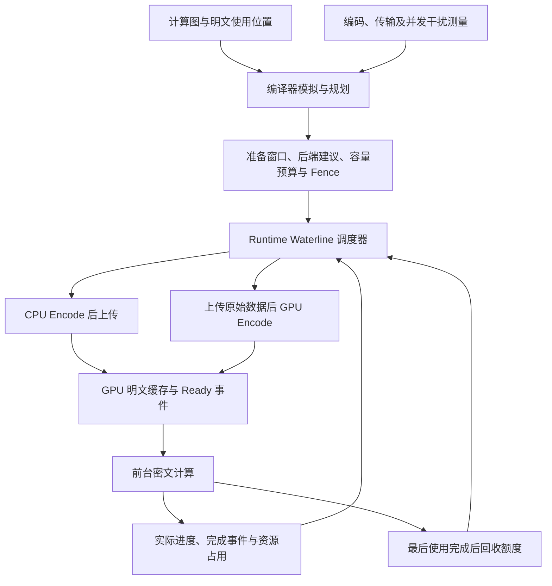

# Waterline：编译器与运行时协同的明文准备计划

**状态：设计计划，尚未实现本文的混合调度机制。** 更新日期：2026-10-11。

本文承接[明文分批与提前上传计划](poseidon-plaintext-prefetch-implementation-plan.zh-CN.md)，描述下一阶段的方法和实现方针。已有 V3 分批、Fence、CPU worker 与按需读取能力；GPU Encode 已有独立实验，但尚未接入本文的运行时调度。已有验证范围见[实现记录](poseidon-plaintext-prefetch-validation.zh-CN.md)与 [GPU Encode 实验说明](../src/poseidon/tests/gpu_encode/README.md)。本文不把已有微基准结果当作 Waterline 的端到端收益。

## 1. 目标与范围

CKKS 明文编码会把原始权重扩展为较大的 RNS/NTT 表示。预先编码并常驻全部明文需要大量显存；到消费者执行时才编码和上传，又会把准备延迟暴露在关键路径上。CPU 编码主要消耗主机计算资源，并需要上传较大的编码结果；GPU 编码可以上传原始数据，但会与密文计算竞争 GPU 计算和内存资源。

Waterline 将这两条路径纳入同一个准备调度：编译器根据测量驱动的模拟，生成每份明文的准备窗口、推荐编码后端和资源预算；runtime 根据实际执行进度选择完整的 CPU Encode 或 GPU Encode，提前准备近期需要的明文，并将显存占用维持在可配置的水位附近。

本阶段以一份完整明文为调度单位，不将同一份明文拆成 CPU FFT 与 GPU RNS/NTT 等跨设备阶段。两条候选路径为：

```text
CPU 路径：读取原始数据 → CPU 完整 Encode → 上传编码明文 → GPU 可用
GPU 路径：读取原始数据 → 上传原始数据 → GPU 完整 Encode → GPU 可用
```

目标是在内存受控、数值语义正确的前提下，减少前台等待明文的时间，并限制后台准备对前台的干扰。缓存填满率、GPU 利用率和 Encode 吞吐量是诊断指标，不能代替端到端性能目标。

首版面向已知计算图中的权重明文、单机执行。跨机器调度、单份 Encode 的 CPU/GPU 阶段拆分、纯 Tensor Core 编码和明文压缩布局均不属于本计划的必要条件。首先完成单 GPU，再扩展到本机多 GPU。

## 2. 可用于论文方法部分的描述

### 2.1 核心机制

Waterline 是一种由编译器提供约束、由运行时择机执行的明文准备机制。编译器从计算图提取明文的使用顺序、编码参数、生命周期和设备位置，通过包含编码、传输与并发干扰的成本模型，确定准备窗口及 CPU/GPU 的分阶段分配建议。运行时在这些窗口内持续准备近期将使用的明文，以可配置的显存水位限制提前准备规模，并在前台工作到来时停止提交非紧急的 GPU 准备任务。接近使用期限的明文升级为必需准备任务，其完成事件控制消费者的启动。

该方法将三种决策关联起来：**何时准备、在哪里编码、允许提前驻留多少数据**。编译器提供全局依赖和资源边界，runtime 处理实际进度与模拟的偏差。正确性依赖显式的数据就绪和内存生命周期，而不依赖耗时预测完全准确。



### 2.2 研究假设与贡献边界

待验证的假设是：对于明文准备存在可利用提前量、且 CPU/GPU 资源需求随阶段变化的 CKKS 工作负载，受准备窗口和水位约束的混合调度，可以比固定单后端、固定比例或仅按需准备减少端到端等待，同时控制显存和前台响应延迟。

论文的方法重点应放在准备窗口、后端选择、前台资源预留与有界后台提交如何共同工作。可配置的缓存水位本身不足以支撑新颖性主张。相关工作比较和完整实验尚待完成，不预先声称最优调度、零干扰、硬实时响应或已获得加速。

## 3. Waterline 的定义和内存约束

### 3.1 配置水位与实际可用预算

对每张 GPU `d` 分别定义以下量，容量单位统一为字节：

| 符号 | 含义 |
| --- | --- |
| `M_d` | 配置允许该执行器使用的 GPU 总容量，不能超过设备容量 |
| `alpha_d` | waterline 比例，例如 `1/2` 或 `2/3`，满足 `0 < alpha_d < 1` |
| `K_d` | 密钥、参数表等常驻占用 |
| `F_d(s)` | 当前调度区间 `s` 内前台密文对象和算子临时空间的保守预留 |
| `S_d` | 尚未归入前述项的分配开销、碎片及安全余量 |
| `P_d(t)` | 时刻 `t` 已承诺给明文准备和驻留的额度 |

定义明文硬预算和机会性填充目标：

```text
H_d(s) = M_d - K_d - F_d(s) - S_d
W_d(s) = min(alpha_d × M_d, H_d(s))
```

`H_d(s)` 为负，或一个不可拆分的必需工作集合超过预算时，应报告计划不可行，不能靠继续预取解决。`F_d(s)` 必须覆盖允许重叠的前台分配，包括仍在运行的算子临时空间；不能只使用“当前占用”或“最大单个算子的工作区”。

`W_d(s)` 是机会性填充上限，`H_d(s)` 是不可突破的容量限制。建议允许临近使用的必需准备超过软水位，但仍严格受硬预算约束；这种情况必须在 trace 中记录。这样不会因水位较低而人为阻止当前消费者执行。若需要严格不越过配置水位，应作为独立策略，其额外等待也要报告。

例如，假设配置容量为 32 GiB、`alpha=1/2`，扣除常驻、前台和安全预留后剩余 18 GiB，则机会性目标为 16 GiB，硬预算为 18 GiB。若另一区间只剩余 12 GiB，则目标降至 12 GiB。这里的数字仅解释定义，不是测量结果或默认推荐值。

### 3.2 先预留，再分配

`P_d(t)` 至少包含以下互不重复的项目：

- 已就绪且仍驻留的明文，以及逻辑 Release 后尚未真正可复用的明文。
- 已获准提交的 GPU 目标缓冲，即使上传或 Encode 尚未完成。
- GPU Encode 输入、输出和工作区的同时存活峰值预留。

每次准入必须先原子地取得额度，再分配和提交。任务完成后按实际可复用的空间归还额度，输出仍驻留的部分继续计费。不能只统计 Ready 明文，否则多个未完成任务会共同突破水位。

硬约束为 `K_d + F_d(s) + S_d + P_d(t) <= M_d`。它成立的前提是所有相关分配经过一致的记账，且预留覆盖实际峰值；在覆盖不完整时，报告只能称为已计费对象的预算，不能声称总显存有上界。内存池保留的空闲块要区分可复用额度与不能复用的占用，避免漏算或重复计费。CUDA 空闲显存采样仅作核对，不能作为唯一准入依据。

原始数据缓存、CPU 编码结果和 pinned buffer 分别具有 Host 预算。CPU 可以继续提前编码，但不能无限累积结果。多 GPU 还需共享 CPU、Host 内存和 PCIe 带宽预算。

### 3.3 水位变化与前台进展

启动时优先准备最早消费者所需的明文，再在初始化窗口内向 `W_d(s)` 填充。达到目标，或窗口中已无合法候选时，结束初始填充；不为凑满水位跨越依赖或内存边界。启动填充成本要单独报告，并计入冷启动时间。

运行中随消费和回收补充。可以增加低水位 `L_d(s)=beta×W_d(s)`，其中 `0<beta<1`：低于 `L` 开始补充，达到 `W` 暂停，以减少频繁启停。`alpha` 控制容量，`beta` 控制滞回；二者都不能代替 GPU 工作量限制。

区间切换前必须检查仍驻留和仍在执行的任务是否满足下一区间预算。不能一面降低水位，一面假设活跃对象立即消失。必要时等待相关事件、释放可淘汰明文，或在编译期限制跨区间驻留。

机会性任务还应为最近消费者尚缺的明文保留额度。不得让远期缓存占满硬预算，导致当前必需明文无法分配。首版使用短预取窗口和近用优先，避免引入复杂淘汰策略；若淘汰未来仍会使用的缓存，必须保留可重新准备的描述，并禁止淘汰仍被 GPU 使用的对象。

## 4. 编译器生成什么

### 4.1 明文准备描述

编译器保留高层 Encode 语义，为目标 GPU 上的明文产生一份“准备描述”。CPU 编码结果与两条路径的中间缓冲由准备任务管理，消费者只依赖统一的 GPU 明文结果。

建议描述以下信息；字段名是设计草案，不是现有协议：

| 字段 | 用途 |
| --- | --- |
| `content / encode_parameters / device` | 原始内容、上下文、槽布局、level、scale、RNS 基及目标设备 |
| `output / consumers / last_use` | 结果标识、消费者集合和最后使用依赖 |
| `earliest_anchor / scope` | 最早允许准备的执行锚点及资源区间 |
| `first_use_anchor / estimated_need_time` | 首次使用依赖和预计就绪期限 |
| `allowed_backends / preferred_backend` | 可用后端及编译器建议 |
| `cpu_cost / gpu_cost / transfer_bytes` | 路径耗时、排队估计和传输量 |
| `host_bytes / pinned_bytes / device_bytes / workspace_bytes` | 各资源的峰值需求 |
| `overlap_budget / batch_limit` | 允许并发的条件及后台提交限制 |

缓存键至少区分内容、上下文、level、scale、槽布局和编码表示；CPU/GPU 后端的数值约定也须一致或显式区分。不能因为原始权重相同就共享不兼容的编码结果。

### 4.2 最早和最晚开始时间

最早锚点是依赖及资源允许开始的逻辑位置；首次使用锚点是必须等待 Ready 的消费者。二者应当引用真实事件或图中依赖，不能仅以 CPU 已提交到哪条指令判断 GPU 已经完成了什么。

对明文 `i` 和后端 `b`，runtime 可根据实际进度更新：

```text
预计最晚开始时间(i,b)
    = 预计消费者需要时间(i)
    - 从当前状态到 GPU Ready 的剩余路径耗时(i,b)
    - 预测误差余量(i,b)
```

剩余路径耗时包含排队、读取、编码、packing 和传输，不能只减一个 Encode kernel 的时间。CPU 和 GPU 的最晚启动时间通常不同。已经开始的任务按剩余工作估计，不重新计入已完成阶段。

这些时间是性能目标。到期意味着提高准备优先级；预测失准时消费者等待 Ready 事件，不能读取未完成数据，也不能越过硬容量限制。

### 4.3 CPU/GPU 比例与模拟

比例按调度区间决定，并由具体任务的后端选择实现，不使用一条全模型固定比例。报告同时记录任务数量比例、预计准备成本和实际资源时间，避免把大小差异很大的明文按数量等同。

编译器需要测量驱动的成本表：CPU/GPU Encode 随 `N`、模数个数、参数、batch 的变化；两条路径的传输和 packing；典型前台算子与 GPU Encode 并发时的耗时变化；CPU Encode 与 Host Boot 等任务的资源竞争。

建议采用以下有限迭代流程，不承诺求得全局最优：

1. 在既有前台计算与设备安排上，提取明文使用序列和资源区间。
2. 将 CPU 准备、GPU 准备、复制引擎与前台任务放入同一模拟，生成初始后端选择和窗口。
3. 检查期限错失、显存峰值及并发干扰；调整一部分任务的后端、提前量或 batch。
4. 重新模拟包含准备任务的完整时间线，达到迭代上限或改进停止后导出可行计划。

runtime 可以在编译器允许的后端、窗口和并发预算内修正选择。成本模型未覆盖的并发组合，首版禁止机会性重叠，待测量后放开。不要仅凭 GPU utilization 较低就认为可以无代价插入 Encode。

缓存只能吸收短期供需不平衡。如果长时间内 CPU 准备速度不足、GPU 又没有可用准备时间，则初始缓存终将耗尽。模拟必须检查各消费前缀是否已有对应明文 Ready；仅比较平均吞吐或字节总量不足以判断可行性。

## 5. Runtime 如何执行

### 5.1 机会性填充与必需准备

机会性填充面向窗口内未来会使用的明文：按预计需要时间排序，在水位、Host 预算和并发预算均允许时准备。GPU 空闲时可以较积极地填充；前台运行时仅使用编译器已允许、经过测量的重叠机会。

必需准备面向已被消费者请求或接近最晚启动时间的明文：优先取得资源，选择预计最早 Ready 的合法路径。若对应任务已经运行，就提升其优先级，不同时再启动另一份 CPU/GPU 编码。所有后端都来不及完成时，允许消费者等待并记录原因。

这里的“请求”包含新的前台执行请求和运行中消费者提出的明文需求。收到请求后停止提交会影响前台的机会性 GPU 工作；请求所依赖的准备必须继续推进。CPU 可在自身预算和前台 CPU 需求允许时继续工作。

### 5.2 让路语义与 stream

建议使用独立的前台计算 stream、低优先级 GPU Encode stream，以及有序管理的 H2D stream，通过每份明文的 Ready 事件连接消费者。

CUDA stream 优先级不保证抢占已经执行的工作，也不保证传输优先级。因此，“立即终止填充”定义为**立即停止提交新的非紧急后台工作，在已提交的小段完成后让路**，不表示取消正在执行的 kernel 或复制。参见 [CUDA 异步执行与 stream 优先级说明](https://docs.nvidia.com/cuda/cuda-programming-guide/02-basics/asynchronous-execution.html)。

runtime 必须同时限制后台 batch、在途批次数和已经提交的工作量。首版最多保留一个小批次在途，在安全的 kernel 序列边界检查是否继续；不能预先把许多批次放进 CUDA 队列。若单份 Encode 序列仍过长，可以在同一 GPU 后端内部设置阶段检查点，但这不引入 CPU/GPU 拆分编码语义。

让路延迟主要受已提交工作、资源竞争和主机响应开销影响。未获得实际最坏情况界限前，提交预算只是控制手段，不是硬实时保证。H2D 也需限制提交深度和块大小，不能通过低优先级 stream 假定它不影响前台传输。

暂停的半成品必须继续计费。保留一个最小可推进任务所需的工作区额度，不能让暂停任务占住全部容量、而恢复它所需的空间又被其他任务占用。

### 5.3 状态、事件和内存回收

准备任务可采用如下状态；CPU/GPU 中间步骤分别记录在任务内部：

```text
候选 → 已准入并预留资源 → 准备中 → GPU Ready → 使用中 → 可回收
                       ↘ 失败，通知所有依赖者并安全清理
```

每个结果只允许一个准备任务取得所有权。取消尚未提交的候选可以立即归还其未使用额度；已提交任务必须等完成事件后清理缓冲。Ready 表示数据已经可供消费者使用，不等于主机已经调用了异步 API。

Release 表示逻辑上不再使用；最后一次消费者执行完成、异步引用结束后，底层存储才可复用。后台不能因看到 Release 指令就提前归还额度。

现有批次 Fence 可作为首版保守边界。后续可用完成事件归还容量额度，减少整批等待。Fence 不能被用成“等待后台一直补到水位”：关闭本区间准入，再完成有限的已提交工作，并保留下一阶段仍需使用的值。等待额度时不持有会阻塞完成处理的锁，也不能堵住唯一负责推进消费者或回收任务的 worker。

### 5.4 调度循环示意

```text
on 前台请求、依赖完成、资源回收、到期提醒:
    收集完成事件，发布 Ready，归还真正可复用的额度
    更新实际执行进度、预计使用时间和资源区间
    如有前台请求，关闭冲突的机会性 GPU 提交
    优先推进必需明文，必要时回收不再使用的远期缓存
    在合法窗口内选择机会性候选
    若水位、前台预留和后端并发预算均满足:
        原子取得任务所有权与所需额度
        仅提交一个受限工作片段
    否则注册事件/到期唤醒，不阻塞负责释放资源的执行路径
```

## 6. 实现的大致方针

### 6.1 复用边界与代码入口

| 部分 | 现有入口 | 计划中的工作 |
| --- | --- | --- |
| 编译器分批与预取 | [PlanPlaintextStreaming.cpp](../third_party/ckks-runtime/third_party/dacapo/lib/Dialect/CKKS/Transforms/PlanPlaintextStreaming.cpp) | 提取使用窗口，引入测量成本、后端选择和区间预算 |
| 生命周期与内存估算 | [PlanRuntimeMemory.cpp](../third_party/ckks-runtime/third_party/dacapo/lib/Dialect/CKKS/Transforms/PlanRuntimeMemory.cpp)、[EstimateRuntimeMemory.cpp](../third_party/ckks-runtime/third_party/dacapo/lib/Dialect/CKKS/Transforms/EstimateRuntimeMemory.cpp) | 覆盖替代路径、在途准备、工作区和事件完成后的回收 |
| 计划格式与校验 | [plan.hpp](../third_party/ckks-runtime/runtime/plan.hpp)、[json_plan_reader.cpp](../third_party/ckks-runtime/runtime/json_plan_reader.cpp)、[verifier.cpp](../third_party/ckks-runtime/runtime/verifier.cpp) | 增加准备描述、能力声明与新语义校验，并同步现有其他计划 I/O 路径 |
| 执行器与 CPU worker | [runtime.hpp](../third_party/ckks-runtime/runtime/runtime.hpp) | 引入准备任务队列、单一所有权、预算准入及进度反馈 |
| GPU 适配层 | [poseidon_gpu_api.cpp](../src/poseidon/runtime_api/poseidon_gpu_api.cpp) | 增加 GPU 完整 Encode 能力、工作区管理与 Ready 事件发布 |
| 异步上传 | [cuda_local_transfer.cpp](../src/poseidon/runtime_api/communication/cuda_local_transfer.cpp) | 明确目标存储可写与数据就绪依赖，验证真实传输重叠 |
| Encode 原型与测量 | [gpu_encode](../src/poseidon/tests/gpu_encode/README.md) | 提取已验证能力，补运行时支持范围和并发成本表 |

当前生产 API 的 `encode_plaintext` 要求 Host 输出。不能仅改变调度器队列就获得 GPU 编码路径，也不能将固定参数的实验 kernel 直接当成通用实现。

当前上传的目标计算流等待还保护异步分配和内存复用顺序。改进重叠时应分别表达“目标缓冲可写”和“结果可读”，不能直接删除等待。只有 trace 中观察到实际重叠，才能报告重叠收益。

### 6.2 计划格式与兼容性

建议采用显式的新计划版本，例如 V4，表达可以由 CPU 或 GPU 实现的明文准备结果。保留 V1/V2/V3 的既有语义和执行路径；旧执行器必须拒绝不认识的新准备语义，不能忽略字段后继续执行。

新版本可以使用一个高层 `PreparePlaintext` 描述目标 GPU 结果，内部选择“Host Encode 后 Transfer”或“原始数据 Transfer 后 Device Encode”。具体名称在协议实现时确定。相关 reader、writer、二进制 I/O、Verifier、打印、能力检查和计划导出必须同步。

编译器与 runtime 使用稳定标识关联准备任务、消费依赖和实际测量。暂时不增加独立的 ForwardNTT/InverseNTT IR；完整 Encode 的成本、内存和完成依赖已足够支持本阶段调度。

### 6.3 分阶段交付

| 阶段 | 实现内容 | 完成标准 |
| --- | --- | --- |
| A：能力和成本基线 | 明确 CPU/GPU 支持的参数范围，统一计时口径，测量工作区及并发干扰 | 每条支持路径通过数值与元信息验证；成本表注明硬件和版本 |
| B：静态水位准备 | 在新计划中先使用固定后端、固定窗口，增加 GPU 完整 Encode、额度管理和 Ready 事件；复用保守 Fence | 启动填充和执行期补充均可运行，预算不足可解释，旧计划回归通过 |
| C：有界后台执行 | 独立 stream、小批次、提交深度限制、前台请求让路和必需任务提升 | 实测让路延迟与前台干扰；持续前台负载下仍可正确推进 |
| D：编译器混合规划 | 加入准备成本模拟、分阶段后端分配和最早/最晚窗口，导出可调整范围 | 静态混合方案可解释；模拟预测与 trace 可逐项比较 |
| E：受约束的运行时调整 | 根据实际剩余时间修正后端选择；在可靠记账后逐步减少整批 Fence | 调整不突破容量和依赖边界；故意扰动耗时仍无死锁或错误 |
| F：本机多 GPU 与模型评估 | 每卡水位、共享 CPU/Host/PCIe 预算，接入实际消费者的模型计划 | 报告端到端收益、内存峰值、等待及多卡竞争，不以独立吞吐替代 |

实现时按独立功能提交和推送；涉及子模块时先提交对应子模块，再更新父仓库引用。测试可使用本机及 `ssh 188Server`，以实际可达设备和已记录硬件配置为准。本文本身只交付设计，不启动上述实现。

## 7. 正确性与验证计划

### 7.1 必须保持的性质

1. **数值和元信息正确。** 两条后端输出具有一致的编码语义、level、scale、RNS 基、NTT 布局和槽含义。完整 GPU FFT 可能存在与 CPU 不同的舍入；分别报告是否逐系数一致，以及端到端 CKKS 误差是否符合既定容差，不能以微基准的局部一致性代替通用验证。
2. **先就绪，后使用。** 消费者必须依赖目标设备上的 Ready 事件；模拟时间到达不能替代依赖。
3. **先预留，后分配。** 所有并发任务共享一致的额度账本；Release 后但尚未完成的对象仍计费。
4. **保持前进。** 等待容量不会阻塞消费者、完成处理或回收；必需明文可取得预留容量，机会性任务不能使其饥饿。
5. **失败可收敛。** 后端失败、读取失败或预算不足时，唤醒所有依赖方，等待已提交工作安全结束并释放资源，不留下永久 Pending 值。

测试覆盖启动未填满、恰好达到水位、并发准入、水位降低、重复消费者、共享原始数据但参数不同、上传未完成即请求、提前 Release、请求在编码期间到达、CPU/复制延迟注入、后端不支持、分配失败和区间切换。CPU encoder 的线程安全未经验证时，继续使用串行 CPU worker 或独立实例，不能直接共享后并发调用。

### 7.2 性能对照与消融

| 对照或消融 | 验证的问题 |
| --- | --- |
| 全量预编码并驻留，仅在装得下时 | 理想就绪条件下的前台基线与内存代价 |
| 现有分批 CPU Encode，无预取/固定字节预取 | 相对当前系统的实际收益 |
| CPU-only 与 GPU-only，使用相同容量和窗口 | 混合后端是否必要 |
| 固定比例与编译器分阶段比例 | 模拟驱动后端选择的贡献 |
| 静态计划与允许 runtime 修正 | 对预测误差和负载变化的适应能力 |
| 不同 waterline、窗口、batch、提交深度 | 内存、等待和让路延迟的取舍 |
| 批次 Fence 与完成事件额度回收 | 细化内存同步的收益和开销 |

首先运行消费者真正读取所准备明文的小图，再扩大到 MLP、模型局部和完整模型。此前独立前台算子与 Encode 并发的实验适合建立干扰成本，不等价于这类供需闭环测试。完整模型的编译成功、实际装入显存和数值完成分别报告。

主指标包括冷启动到首个结果时间、稳态端到端耗时、吞吐和前台延迟分布。辅助指标包括明文等待时间、期限错失、CPU/GPU 实际分配比例、H2D 字节与时间、重复编码、前台算子减速、后台让路延迟、调度开销，以及 GPU/Host/pinned 的活跃峰值与池保留量。单请求实验不冒充服务请求的 P99 测量。

测试既包含有空闲间隙的负载，也包含 GPU 持续忙、CPU 供应不足和预测明显失准的情况。扫描 waterline 时保持其他预算和工作负载一致；初始填充不得从冷启动指标中隐藏。使用 CUDA events 与 trace 核对跨 stream 重叠，并记录温度、时钟、重复运行与采样方法。

论文中的每项收益都应对应完整对照实验。实现完成前，这些内容是待检验的设计假设，不写成实验结论。
